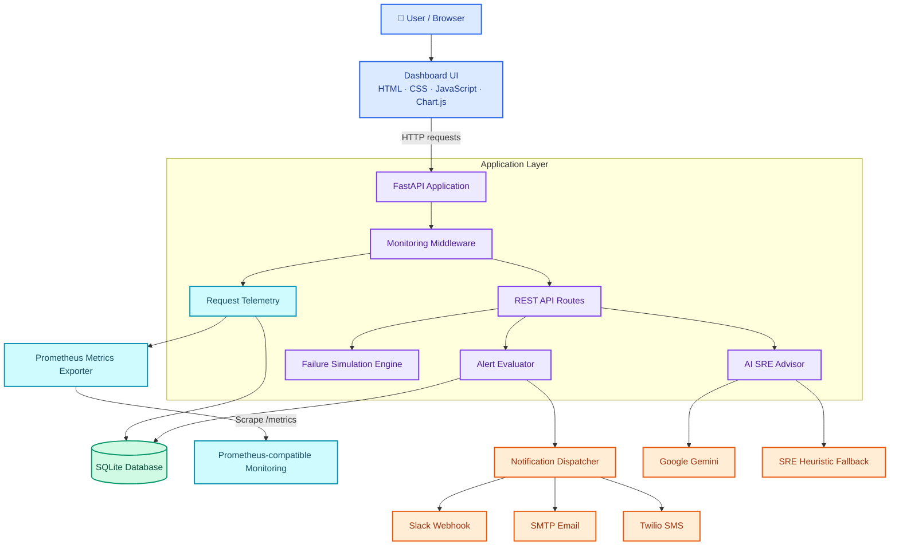
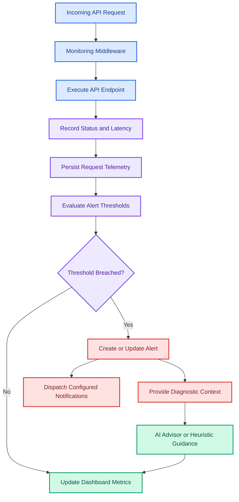

<p align="center">
  
</p>

<p align="center">
  
</p>

<p align="center">
  
  
  
  
  
</p>

<h1 align="center">🚀 NovaPulse AI</h1>

<p align="center">
  <strong>FastAPI API Monitoring &amp; Observability Dashboard</strong>
</p>

<p align="center">
  Monitor API health, analyze request performance, investigate incidents, and explore controlled failure scenarios through an interactive observability dashboard.
</p>

---

## 🧭 Quick Navigation

<p align="center">
  <a href="#about"></a>
  <a href="#features"></a>
  <a href="#screenshots"></a>
  <a href="#system-architecture"></a>
  <a href="#quick-start"></a>
  <a href="#api-endpoints"></a>
  <a href="#testing"></a>
  <a href="#deployment"></a>
</p>

<p align="center">
  <a href="#system-architecture">
    
  </a>
  <a href="#quick-start">
    
  </a>
</p>

---

<a id="about"></a>

## 📘 About the Project

**NovaPulse AI** is a full-stack API monitoring and observability platform for FastAPI applications.

It combines request telemetry, performance metrics, alert management, controlled failure simulations, and AI-assisted incident analysis in one dashboard.

The project includes a FastAPI backend, SQLite-based request and incident storage, interactive charts, an animated web interface, Prometheus-compatible metrics, notification integrations, and a Google Gemini-powered SRE advisor with a heuristic fallback.

### 🎯 Project Objectives

- Monitor API requests and response performance.
- Track request volume, availability, latency, and HTTP status codes.
- Detect configured error and latency thresholds.
- Simulate common API failure scenarios.
- Display incident information and root-cause analysis.
- Export metrics in Prometheus text exposition format.
- Explore AI-assisted recommendations and troubleshooting.
- Provide a responsive dashboard with dark and light themes.

---

<a id="features"></a>

## ✨ Key Features

### 📡 API Observability

- Request and response monitoring through FastAPI middleware.
- Average latency and p95 and p99 latency metrics.
- Request volume and requests-per-minute tracking.
- HTTP status-code distribution, including 2xx, 4xx, and 5xx responses.
- Availability and service-health information.
- Request logging with recorded IP and User-Agent information.

### 🚨 Incident & Alert Management

- Configurable downtime and high-latency thresholds.
- Detection of HTTP 500 errors and elevated error rates.
- Rate-limit incident simulation.
- Active and historical alert views.
- Alert acknowledgement and clearing operations.
- Notification dispatchers for Slack webhooks, SMTP email, and Twilio SMS.

### 🧪 Chaos & Failure Simulation

Explore controlled scenarios to understand how an API behaves when common failures occur:

- Authentication failure — HTTP 401.
- Slow response or timeout scenario.
- Server-side exception — HTTP 500.
- Rate-limit response — HTTP 429.

The documented simulation workflows provide diagnostic output and suggested remediation steps.

### 🤖 AI SRE Advisor

- Google Gemini 1.5 Flash integration.
- Built-in SRE heuristic fallback.
- AI-generated recommendations.
- Natural-language troubleshooting questions.
- Accept or dismiss recommendation interactions.

### 🎨 Interactive Dashboard

- Animated particle-mesh background.
- Glowing service-status indicators.
- Animated SVG heartbeat line.
- Orbital loading effects and animated empty states.
- Interactive charts with Chart.js.
- Glassmorphism cards and frosted surfaces.
- Dark and light themes with a persisted preference.
- Toast notifications and confirmation modals.
- Synthesized Web Audio API feedback with a mute control.

---

<a id="screenshots"></a>

## 📸 Screenshots

Use this section to showcase the actual interface from your running NovaPulse AI application.

<table>
  <tr>
    <td align="center" width="50%">
      <strong>📊 Monitoring Dashboard</strong><br/><br/>
      <br/>
      <sub>API health, requests, latency, and service metrics.</sub>
    </td>
    <td align="center" width="50%">
      <strong>📈 Metrics &amp; Analytics</strong><br/><br/>
      <br/>
      <sub>Request trends, status codes, and latency visualization.</sub>
    </td>
  </tr>
  <tr>
    <td align="center" width="50%">
      <strong>🚨 Incident &amp; Alerts</strong><br/><br/>
      <br/>
      <sub>Incident detection, alert history, and acknowledgement.</sub>
    </td>
    <td align="center" width="50%">
      <strong>🤖 AI SRE Advisor</strong><br/><br/>
      <br/>
      <sub>AI-assisted recommendations and troubleshooting.</sub>
    </td>
  </tr>
</table>

> **Screenshot setup:** These image paths are placeholders. Capture the real application screens, save them in the `screenshots/` directory using the filenames shown, and commit the images to your repository. Remove any entries for screens that are not present in your application.

---

<a id="system-architecture"></a>

## 🏗️ System Architecture

<p align="center">
  <a href="#system-architecture">
    
  </a>
</p>



### 🔄 Monitoring & Incident Workflow



> The diagrams represent the documented application design. Actual deployment topology and middleware execution order should be confirmed against the implementation.

---

<a id="tech-stack"></a>

## 🛠️ Tech Stack

| Technology | Purpose |
|---|---|
| Python | Backend programming |
| FastAPI | REST API framework |
| Uvicorn | ASGI development server |
| SQLite | Local telemetry, alert, and simulation storage |
| Prometheus exposition | Metrics export |
| HTML5, CSS, JavaScript | Dashboard interface |
| Tailwind CSS | Utility-based styling |
| Chart.js | Interactive metrics charts |
| Web Audio API | Synthesized sound feedback |
| Google Gemini 1.5 Flash | AI-assisted SRE recommendations and Q&A |
| Pytest | Automated API tests |
| Vercel | Documented deployment target |

---

<a id="quick-start"></a>

## ⚡ Quick Start — Run Locally

### Prerequisites

Install the following tools before starting:

- Python 3.10 or a compatible version supported by your dependencies.
- Git.
- pip, included with standard Python installations.

### 1. Clone the Repository

Use your actual GitHub repository URL if it differs from the one below.

```bash
git clone https://github.com/dhanushgopi2456/fast-api-monitoring-board.git
cd fast-api-monitoring_board
```

> If the repository URL or folder name differs in your GitHub account, update these commands to match the actual repository.

### 2. Install Dependencies

```bash
python -m venv .venv
```

Activate the environment.

**Windows PowerShell:**

```powershell
.venv\Scripts\Activate.ps1
```

**Windows Command Prompt:**

```bat
.venv\Scripts\activate.bat
```

**macOS / Linux:**

```bash
source .venv/bin/activate
```

Install the dependencies:

```bash
python -m pip install --upgrade pip
pip install -r requirements.txt
```

### 3. Start the Application

Run the project launcher:

```bash
python run.py
```

Alternatively, start FastAPI with Uvicorn:

```bash
python -m uvicorn app.main:app --host 127.0.0.1 --port 8000 --reload
```

### 4. Open the Dashboard

| Resource | Local URL |
|---|---|
| Dashboard | [http://127.0.0.1:8000/](http://127.0.0.1:8000/) |
| Swagger API Documentation | [http://127.0.0.1:8000/docs](http://127.0.0.1:8000/docs) |
| Prometheus Metrics | [http://127.0.0.1:8000/metrics](http://127.0.0.1:8000/metrics) |
| API Health Check | [http://127.0.0.1:8000/health](http://127.0.0.1:8000/health) |

---

<a id="failure-simulations"></a>

## 🧪 Failure Simulation Matrix

NovaPulse AI documents four scenarios for exploring API error detection and diagnostic guidance.

| Scenario | Trigger | Expected Behavior | Diagnostic Focus |
|---|---|---|---|
| Authentication Failure | `/api/auth/test` | HTTP 401 | Missing or invalid authentication |
| Slow Response | `/simulate-timeout` | Response delay exceeding 3 seconds | Latency threshold breach |
| Server Error | `/simulate-error` | HTTP 500 | Server-side failure investigation |
| Rate Limit | `/simulate-rate-limit` | HTTP 429 | Request quota or rate-limit behavior |

### Example Root-Cause Analysis Areas

- **HTTP 401:** Inspect the Authorization header and authentication configuration.
- **Slow response:** Investigate dependency latency and slow database or service operations.
- **HTTP 500:** Review application logs and exception details.
- **HTTP 429:** Inspect request frequency, configured quotas, and client retry behavior.

The exact incident text and root-cause messages depend on the application's configured simulations.

> **Safety:** Run failure simulations against your local or authorized test environment. These endpoints deliberately generate error responses and should not be exposed without suitable safeguards on production systems.

---

<a id="api-endpoints"></a>

## 📋 API Endpoints Catalog

### Core REST Service

| Method | Endpoint | Purpose |
|---|---|---|
| `GET` | `/health` | Health status and system metrics |
| `GET` | `/users` | Sample user directory |
| `GET` | `/products` | Sample product catalog |
| `GET` | `/simulate-error` | Simulate an HTTP 500 response |
| `GET` | `/simulate-timeout` | Simulate a slow response |
| `GET` | `/simulate-rate-limit` | Simulate HTTP 429 |
| `GET` | `/api/auth/test` | Simulate an HTTP 401 authentication check |

### Observability & Incident Management

| Method | Endpoint | Purpose |
|---|---|---|
| `GET` | `/metrics` | Prometheus text exposition metrics |
| `GET` | `/api/metrics/summary` | Dashboard summary metrics |
| `GET` | `/api/metrics/timeseries` | Historical time-series buckets |
| `GET` | `/api/logs` | Recent request logs |
| `GET` | `/api/alerts` | Active and historical alerts |
| `POST` | `/api/alerts/{id}/ack` | Acknowledge an alert |
| `POST` | `/api/alerts/clear` | Clear alerts |
| `POST` | `/api/simulations/run` | Run a failure simulation |
| `GET` | `/api/ai/recommendations` | Retrieve AI recommendations |
| `POST` | `/api/ai/ask` | Submit a natural-language SRE question |
| `POST` | `/api/notifications/test` | Test configured notification channels |

### Explore the API Interactively

Open the Swagger UI after starting the application:

[http://127.0.0.1:8000/docs](http://127.0.0.1:8000/docs)

Use it to inspect the registered endpoints, review request formats, and send test requests.

---

<a id="alerting"></a>

## 🚨 Alerting & Notifications

The project documents alert evaluation for the following conditions:

| Condition | Documented Threshold |
|---|---|
| Slow response | More than 3 seconds |
| Server error | HTTP 500 |
| Error-rate increase | More than 5% |
| Service downtime | Detected downtime |
| Rate limiting | HTTP 429 or rate-limit scenario |

### Supported Notification Integrations

- **Slack:** Webhook-based notifications.
- **Email:** SMTP-based delivery.
- **SMS:** Twilio integration.

Configuration, credentials, and delivery behavior depend on the implementation and environment settings. Keep webhook URLs, SMTP passwords, and Twilio credentials out of source control.

---

<a id="ai-advisor"></a>

## 🤖 AI SRE Advisor

The AI advisor combines telemetry context with diagnostic assistance.

Documented capabilities include:

- Generating troubleshooting recommendations.
- Answering free-form SRE questions.
- Suggesting diagnostic next steps.
- Falling back to built-in heuristic guidance when the AI integration is unavailable.
- Allowing users to accept or dismiss recommendations in the dashboard.

### AI Configuration

The documented integration uses Google Gemini 1.5 Flash. If API-key configuration is required by your local setup, configure it using the environment-variable names expected by your actual code.

For production usage, validate AI-generated suggestions before applying them. Treat outputs as assistance rather than a substitute for reviewing logs, metrics, and application behavior.

---

<a id="visual-implementation"></a>

## 🎨 Visual & Interactive Experience

The README documents these interface features:

- **Animated canvas:** Particle mesh background.
- **Status beacons:** Pulsing service-status indicators.
- **Heartbeat animation:** SVG ECG-style vital line.
- **Loading states:** Orbital scanners and animated indicators.
- **Notifications:** Stacked toast messages with countdown bars.
- **Confirmation dialogs:** Confirmation for destructive actions.
- **Audio feedback:** Synthesized click, navigation, success, warning, and error sounds.
- **Theme switching:** Dark and light palettes with a persisted preference.
- **Glassmorphism:** Frosted surfaces and blurred backgrounds.
- **Interactive analytics:** Chart.js charts and visual telemetry summaries.

These features aim to make operational information easier to explore while preserving the utility of the underlying API.

---

<a id="testing"></a>

## 🧪 Testing

### Run the Pytest Suite

The original project README documents 13 API tests.

```bash
python -m pytest tests/test_api.py -v
```

### Run End-to-End Verification

```bash
python tests/verify_all.py
```

### Testing Areas

The project documentation describes testing and verification of:

- API health and core routes.
- Monitoring and metrics endpoints.
- Alert behavior.
- Failure simulation scenarios.
- Dashboard-related API workflows.

Run the tests in your current environment to confirm the actual results. A previously documented pass rate should not be treated as a fresh test result.

---

<a id="project-structure"></a>

## 📂 Project Structure

```text
fast-api-monitoring_board/
├── app/
│   ├── main.py              # FastAPI application, routes, static mounts
│   ├── config.py            # Configuration and alert thresholds
│   ├── database.py          # SQLite schema, queries, request logging
│   ├── monitoring.py        # Metrics calculation and exporter
│   ├── alerts.py             # Alert evaluation and notifications
│   ├── simulation.py         # Failure scenarios and RCA
│   ├── ai_advisor.py         # Gemini integration and heuristic fallback
│   └── models.py             # Pydantic schemas
├── static/
│   ├── index.html            # Dashboard UI
│   ├── app.js                # Frontend behavior, audio, canvas, charts
│   ├── styles.css            # Styling, animation, themes
│   └── favicon.svg           # Vector branding
├── frontend/
│   ├── package.json
│   ├── vite.config.ts
│   ├── tsconfig.json
│   ├── tailwind.config.js
│   └── src/
│       ├── App.tsx
│       ├── main.tsx
│       └── utils/audio.ts
├── tests/
│   ├── test_api.py            # API test suite
│   └── verify_all.py          # End-to-end verification
├── docs/
│   ├── ARCHITECTURE.md
│   ├── SETUP.md
│   ├── ALERT_RULES.md
│   ├── SIMULATION_GUIDE.md
│   └── TROUBLESHOOTING.md
├── requirements.txt
├── run.py
└── README.md
```

This structure follows the organization documented for the project. If the current repository differs, update the tree to match its actual files.

---

<a id="deployment"></a>

## ☁️ Deployment

The original project documentation describes a Vercel deployment configuration using `vercel.json` and `api/index.py`.

### Option A — Deploy with Vercel CLI

Install the Vercel CLI:

```bash
npm install -g vercel
```

From the project root, run:

```bash
vercel
```

Follow the CLI prompts to configure the project.

### Option B — Deploy Through the Vercel Dashboard

1. Push your project to GitHub.
2. Visit [Vercel New Project](https://vercel.com/new).
3. Import the repository.
4. Review the Python runtime configuration and entry point.
5. Configure required environment variables.
6. Deploy and inspect the build logs.

### Deployment Considerations

- SQLite data may be ephemeral in serverless environments.
- The documented configuration uses `/tmp/monitoring.db` for SQLite on Vercel.
- `/tmp` storage should not be treated as durable long-term storage.
- External API credentials must be configured securely.
- Validate that metrics, alerts, notification integrations, and AI requests work in the deployed environment.
- Ensure that failure simulation endpoints cannot be abused by unauthorized users.

Deployment success depends on the current repository configuration, runtime compatibility, and hosting platform support.

---

<a id="security"></a>

## 🔐 Security & Operational Considerations

Before exposing the dashboard to external users:

- Protect diagnostic and management endpoints with suitable access controls.
- Avoid returning sensitive request headers, IP data, or internal exception details to unauthorized users.
- Store integration credentials in environment variables or a secrets manager.
- Apply rate limits to endpoints that trigger expensive operations or notifications.
- Restrict failure simulations to authorized environments.
- Validate and sanitize incoming request data.
- Review log retention and personally identifiable information handling.
- Treat AI-generated diagnostics as untrusted suggestions that require verification.

These are recommended operational checks; they do not imply that every item is already implemented.

---

<a id="definition-of-done"></a>

## ✅ Project Checklist

The original README documents the following completion checklist:

- [x] FastAPI sample API and documented core endpoints.
- [x] Request metrics and response-time collection.
- [x] SQLite-based telemetry storage.
- [x] Dashboard metrics and service-status display.
- [x] Alert rules and notification integrations.
- [x] Four documented failure simulation scenarios.
- [x] Root-cause analysis output.
- [x] Animated graphics, notification toasts, and audio feedback.
- [x] AI recommendations and dark/light mode.
- [x] Documentation and automated tests.

Run the application and test suite to verify the current state before describing these items as independently validated.

---

## 📚 Additional Documentation

The repository's documented `docs/` directory includes:

| Document | Purpose |
|---|---|
| `ARCHITECTURE.md` | Architecture and data flow |
| `SETUP.md` | Installation and configuration |
| `ALERT_RULES.md` | Alert thresholds and channels |
| `SIMULATION_GUIDE.md` | Failure simulation workflows |
| `TROUBLESHOOTING.md` | Troubleshooting and maintenance |

---

<p align="center">
  
</p>

<p align="center">
  <strong>⚡ Observe. Diagnose. Improve. Repeat.</strong><br/>
  Turning API telemetry into actionable operational insight.
</p>

<p align="center">
  <a href="https://github.com/dhanushgopi2456">
    
  </a>
  <a href="https://www.linkedin.com/in/dhanush-gopi-kavala-a460a528b/">
    
  </a>
</p>
